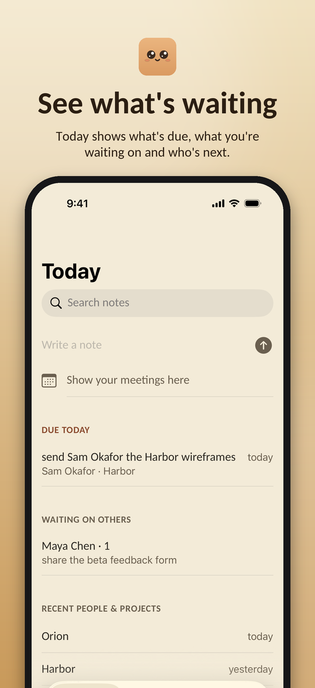
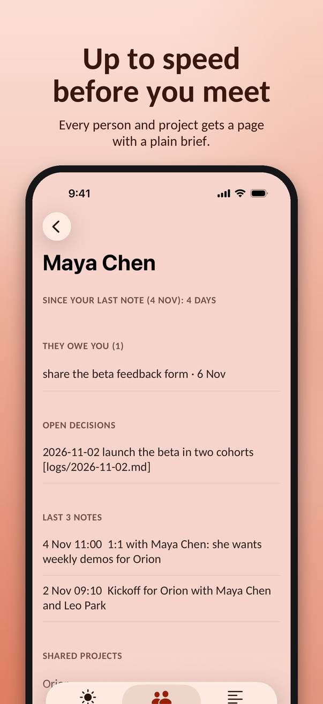
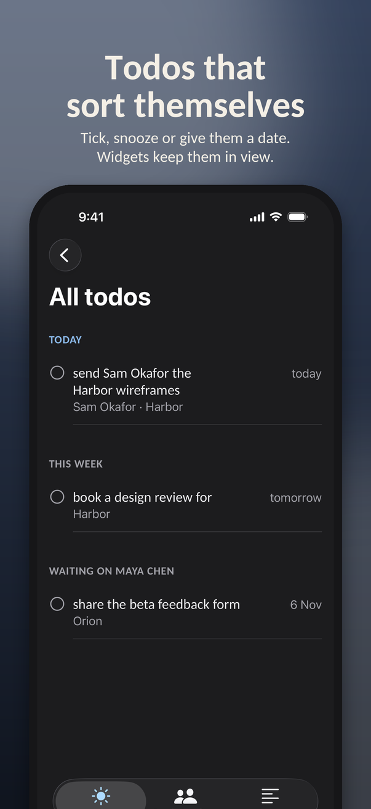
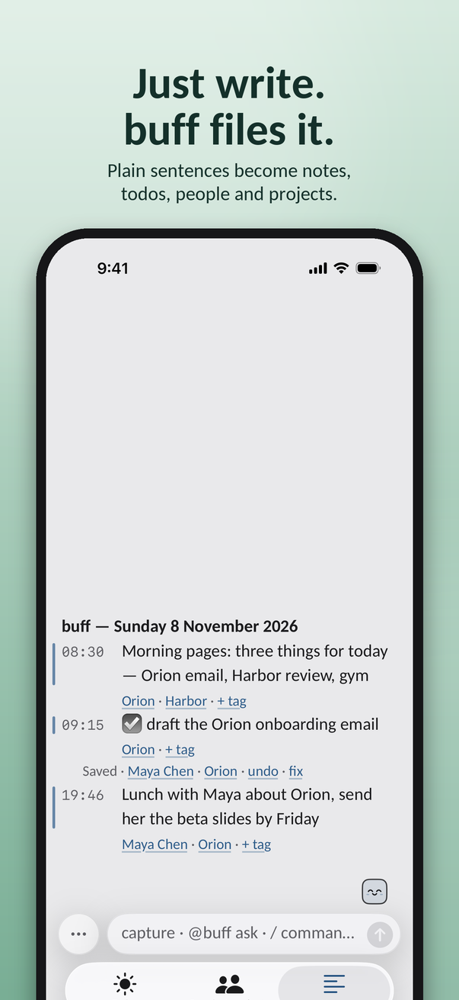
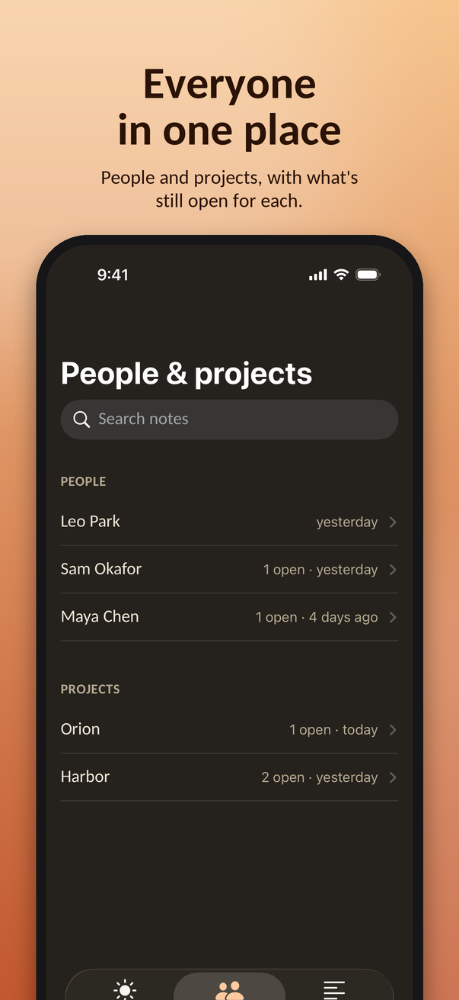
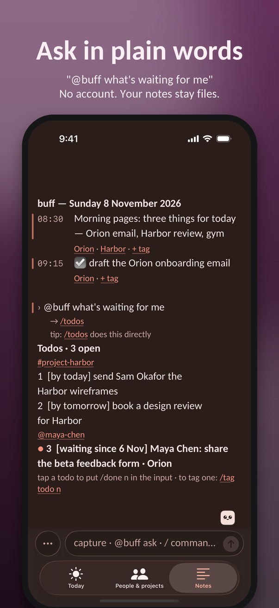

**buff is the place for short work notes about people and projects.** It tells you what's waiting and gets you up to speed before a meeting.

- **Today** shows what's overdue, what's due and what you're waiting on, plus your next meeting.
- **People & projects** gives everyone you work with a page, with a plain brief: what they owe you, what you owe them, open decisions and your last notes.
- **Notes** is where you write, in plain words. `send Maya the slides by Friday` becomes a todo due Friday, filed under Maya.

Tick and snooze todos, keep them on your Home Screen with a widget, and edit or delete any note with undo. Your notes stay plain markdown files in your own iCloud Drive. No account, no analytics, no ads.

Free for iPhone and iPad (iOS 18 or later). **New in 2.0:** three screens, meetings, a real todo list, widgets and editing any note. [What's new →]({{ '/docs/' | relative_url }}#new-in-20)

<a class="button" href="{{ '/docs/' | relative_url }}">Read buff docs →</a> <a class="button secondary" href="{{ '/support/' | relative_url }}">Get support</a>

All names in the pictures are made-up demo data.

[buff docs](docs/index.md) · [Privacy policy](privacy.md) · [Support](support.md)
